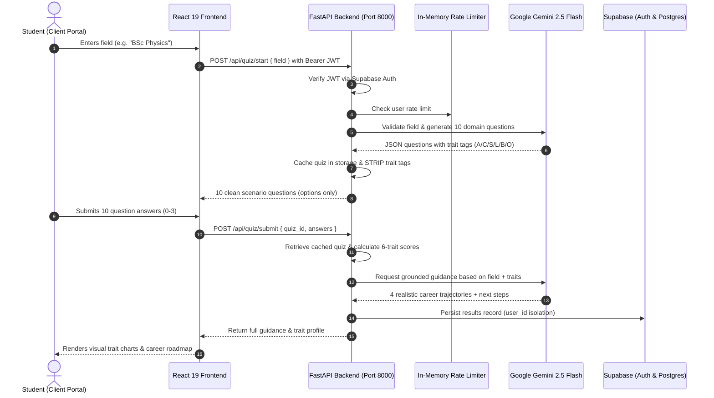

# Raah (राह) — Career Intelligence & Guided Discovery Platform 🧭⚡

[](https://fastapi.tiangolo.com)
[](https://www.python.org/)
[](https://react.dev/)
[](https://vitejs.dev/)
[](https://tailwindcss.com)
[](https://supabase.com)
[](https://ai.google.dev/)
[](https://docs.pytest.org)

**Raah (राह)** is a full-stack, AI-powered career intelligence and discovery platform engineered for high school, undergraduate, and postgraduate students. Rather than relying on generic, static question banks, Raah uses **Google Gemini** (`google-genai` SDK) to dynamically generate on-demand, domain-specific psychometric assessments for **any academic course, stream, or vocational interest** (e.g., *"BSc Physics"*, *"B.Tech CSE"*, *"BCom Finance"*, *"Interior Design"*, *"12th Science"*).

Student evaluations are analyzed across **6 core cognitive and behavioral trait dimensions**, generating 4 grounded, realistic career trajectories backed by verified **Supabase PostgreSQL** authentication with strict Row Level Security (RLS).

---

## 📑 Table of Contents

- [Core Highlights](#-core-highlights)
- [How It Works (System Architecture)](#-how-it-works-system-architecture)
- [The 6 Cognitive Trait Dimensions](#-the-6-cognitive-trait-dimensions)
- [Repository Structure](#-repository-structure)
- [Tech Stack](#-tech-stack)
- [Prerequisites](#-prerequisites)
- [Quick Start Guide](#-quick-start-guide)
  - [1. Database Configuration (Supabase)](#1-database-configuration-supabase)
  - [2. Backend Setup (FastAPI)](#2-backend-setup-fastapi)
  - [3. Frontend Setup (React 19 + Vite)](#3-frontend-setup-react-19--vite)
- [Environment Variables](#-environment-variables)
- [Available Scripts](#-available-scripts)
- [API Endpoints Reference](#-api-endpoints-reference)
- [Security & Defense-in-Depth](#-security--defense-in-depth)
- [Automated Testing & Verification](#-automated-testing--verification)

---

## ✨ Core Highlights

- 🧠 **Dynamic Field-Specific Quizzes**: Students provide any free-text stream or course name. Gemini formulates 10 practical, real-world situational multiple-choice questions tailored specifically to that domain.
- 🛡️ **Zero Trait Leakage**: Trait tags (`A`, `C`, `S`, `L`, `B`, `O`) are stripped by the backend before transmitting questions to the client, preventing inspection bias and tampering.
- 🎯 **Grounded, Realistic Career Pathways**: Delivers 4 tailored trajectories with specific "Why it fits you" rationales, immediate actionable next steps (projects, GitHub portfolios, internships), and recognized entrance exams/certifications (e.g., GATE, JAM, CAT, CFA, AWS).
- 🔒 **Enterprise-Grade Security**: Supabase Auth (Email/Password & Google OAuth), JWT Bearer token validation, Row Level Security (RLS) data isolation, adversarial prompt injection defense, and sliding-window rate limiting.
- 📊 **Student Analytics Portal**: Historical assessment timeline, cognitive trait distribution percentages, detailed recommendations breakdown, and ability to review or prune past attempts.

---

## 🔄 How It Works (System Architecture)



---

## 🧬 The 6 Cognitive Trait Dimensions

Every dynamic assessment option is calibrated to one of 6 foundational cognitive and vocational dimensions:

| Code | Trait Name | Primary Competencies | Typical Orientations |
| :---: | :--- | :--- | :--- |
| **A** | **Analytical** | Logic, data analysis, systematic research, empirical reasoning | Data Science, Research, Quantitative Modeling, Algorithms |
| **C** | **Creative** | Conceptual thinking, visual design, UX, innovative problem-solving | Product Design, Creative Direction, Architecture, Content |
| **S** | **Social** | Empathy, mentorship, team collaboration, human impact, advocacy | Healthcare, Teaching, Community Leadership, HR, Counseling |
| **L** | **Leadership** | Strategic foresight, decisive planning, initiative, management | Entrepreneurship, Product Management, Operations, Consulting |
| **B** | **Hands-on Building** | Engineering execution, tooling, prototyping, physical construction | DevOps, Hardware Prototyping, Robotics, Applied Engineering |
| **O** | **Organized** | Quality governance, operational precision, workflow optimization | Compliance, Project Coordination, Systems Audit, QA |

---

## 📁 Repository Structure

```text
Raah/
├── frontend/                     # React 19 + Vite + Tailwind CSS v4 Client
│   ├── public/                   # Static assets & brand logo
│   ├── src/
│   │   ├── assets/               # SVG icons, illustrations, logos
│   │   ├── components/           # Reusable UI (Navbar, PortalLayout, PasswordStrength, etc.)
│   │   ├── context/              # AuthContext (Supabase session, profile sync, state)
│   │   ├── data/                 # Local persistence helpers & storage keys
│   │   ├── lib/                  # Supabase client helper & centralized API client
│   │   ├── pages/                # Client views:
│   │   │   ├── Login.jsx         # Email/password & Google OAuth authentication
│   │   │   ├── SignUp.jsx        # Student registration with validation
│   │   │   ├── ForgotPassword.jsx# Password recovery initiation
│   │   │   ├── ResetPassword.jsx # Secure callback password reset
│   │   │   ├── Dashboard.jsx     # Overview metrics, latest results & quick-start
│   │   │   ├── TakeAssessment.jsx# Dynamic field input & interactive 10-Q test
│   │   │   ├── MyResults.jsx     # Trait distributions & detailed recommendations
│   │   │   ├── ExploreCareers.jsx# Career exploration view
│   │   │   ├── SavedCareers.jsx  # Shortlisted career paths
│   │   │   ├── Profile.jsx       # Student profile & academic details
│   │   │   └── NotFound.jsx      # 404 handler
│   │   ├── App.jsx               # Client routes, protected pathways & toast config
│   │   ├── index.css             # Tailwind v4 import & custom styles
│   │   └── main.jsx              # React DOM entry point
│   ├── .env.example              # Frontend environment variables template
│   ├── package.json              # Frontend scripts & dependencies
│   └── vite.config.js            # Vite bundler configuration
│
├── backend/                      # High-Performance FastAPI REST Server
│   ├── app/
│   │   ├── __init__.py
│   │   ├── main.py               # FastAPI application, CORS, health & dashboard endpoints
│   │   ├── config.py             # Pydantic Settings (.env configuration loader)
│   │   ├── deps.py               # Dependency injection: Bearer token auth verification
│   │   ├── schemas.py            # Pydantic models (QuizStart, QuizSubmit, Dashboard, Profile)
│   │   ├── supa.py               # Supabase anonymous & service role client initialization
│   │   ├── routers/              # Modular API routers:
│   │   │   ├── quiz.py           # POST /api/quiz/start & POST /api/quiz/submit
│   │   │   ├── results.py        # GET & DELETE /api/results endpoints
│   │   │   └── auth.py           # Auth helper endpoints
│   │   ├── services/             # Business logic & integrations:
│   │   │   ├── llm.py            # Gemini integration (quiz generation & career synthesis)
│   │   │   ├── rate_limiter.py   # Sliding-window rate limiter per student
│   │   │   ├── storage.py        # Supabase quizzes & results database persistence
│   │   │   └── scoring.py        # Psychometric trait evaluation utilities
│   │   └── data/                 # Reference data banks
│   ├── supabase/
│   │   └── schema.sql            # Table definitions (profiles, results), triggers & RLS
│   ├── tests/                    # Test suite:
│   │   ├── test_api.py           # Mocked API endpoint & security tests
│   │   ├── test_scoring.py       # Trait mathematical scoring verification
│   │   └── verify_live_e2e.py    # Live end-to-end adversarial verification script
│   ├── .env.example              # Backend environment template
│   ├── requirements.txt          # Python dependencies
│   └── README.md                 # Backend-specific documentation
│
├── supabase/
│   └── schema.sql                # Monorepo database migrations & RLS configuration
├── package.json                  # Root monorepo runner scripts
├── .gitignore                    # Git ignore rules
└── README.md                     # Project documentation
```

---

## 💻 Tech Stack

### Frontend
- **Framework**: [React 19](https://react.dev/) + [Vite 8](https://vitejs.dev/)
- **Styling**: [Tailwind CSS v4](https://tailwindcss.com/)
- **Routing**: [React Router DOM v7](https://reactrouter.com/)
- **Icons & UI**: [Lucide React](https://lucide.dev/) & Google Material Symbols
- **Notifications**: [React Hot Toast](https://react-hot-toast.com/)
- **Authentication Client**: [@supabase/supabase-js v2](https://supabase.com/docs/reference/javascript)

### Backend
- **Framework**: [FastAPI 0.115+](https://fastapi.tiangolo.com/)
- **ASGI Server**: [Uvicorn](https://www.uvicorn.org/)
- **AI Intelligence**: [Google Gemini 2.5 Flash](https://ai.google.dev/) via `google-genai` SDK
- **Data Validation**: [Pydantic v2](https://docs.pydantic.dev/) + `pydantic-settings`
- **Database Client**: `supabase-py`
- **Testing**: [Pytest](https://docs.pytest.org/) + `httpx`

### Database & Security
- **Engine**: [Supabase](https://supabase.com/) (Managed PostgreSQL 15+)
- **Security**: PostgreSQL Row Level Security (RLS) policies
- **Automation**: PL/pgSQL database triggers for profile synchronization

---

## 📋 Prerequisites

Before setting up the project locally, ensure you have installed:
- **Node.js**: `v18.0.0` or higher (Node 20+ recommended)
- **Python**: `3.10` or higher (Tested on Python `3.12`)
- **Git**: Installed and configured
- **Accounts**:
  - A free [Supabase](https://supabase.com/) account and project
  - A [Google AI Studio](https://aistudio.google.com/) API key (for Gemini)

---

## 🚀 Quick Start Guide

### 1. Database Configuration (Supabase)

1. Open your project on the [Supabase Dashboard](https://supabase.com/dashboard).
2. Navigate to **SQL Editor** -> **New Query**.
3. Copy and run the entire contents of [`supabase/schema.sql`](supabase/schema.sql).
   This creates:
   - The `profiles` table with automatic user creation triggers
   - The `results` table with Row Level Security (RLS) enabled
   - Selective user-scoped RLS policies ensuring students can only access their own data
   - Database performance indexes for low-latency queries

---

### 2. Backend Setup (FastAPI)

1. Open a terminal and navigate to the `backend/` directory:
   ```bash
   cd backend
   ```

2. Create and activate a Python virtual environment:
   ```bash
   # Windows (PowerShell)
   python -m venv venv
   .\venv\Scripts\Activate.ps1

   # macOS / Linux
   python3 -m venv venv
   source venv/bin/activate
   ```

3. Install backend dependencies:
   ```bash
   pip install -r requirements.txt
   ```

4. Configure environment variables:
   ```bash
   cp .env.example .env
   ```
   Edit `backend/.env` with your actual credentials:
   ```env
   SUPABASE_URL=https://your-project.supabase.co
   SUPABASE_ANON_KEY=your-supabase-anon-key
   SUPABASE_SERVICE_KEY=your-supabase-service-key
   GEMINI_API_KEY=your-gemini-api-key
   PORT=8000
   FRONTEND_URL=http://localhost:5173
   CORS_ORIGINS=http://localhost:5173,http://127.0.0.1:5173,http://localhost:3000
   ```

5. Start the FastAPI development server:
   ```bash
   python -m uvicorn app.main:app --reload --port 8000
   ```
   - API Root: `http://localhost:8000`
   - Interactive Swagger Docs: `http://localhost:8000/docs`
   - ReDoc: `http://localhost:8000/redoc`

---

### 3. Frontend Setup (React 19 + Vite)

1. Open a new terminal and navigate to the `frontend/` directory:
   ```bash
   cd frontend
   ```

2. Install dependencies:
   ```bash
   npm install
   ```

3. Configure environment variables:
   ```bash
   cp .env.example .env
   ```
   Edit `frontend/.env`:
   ```env
   VITE_SUPABASE_URL=https://your-project.supabase.co
   VITE_SUPABASE_ANON_KEY=your-supabase-anon-key
   VITE_API_URL=http://localhost:8000
   ```

4. Start the frontend development server:
   ```bash
   npm run dev
   ```
   Open your browser at **`http://localhost:5173`**.

---

## ⚙️ Environment Variables

### Backend (`backend/.env`)

| Variable | Required | Description | Example |
| :--- | :---: | :--- | :--- |
| `SUPABASE_URL` | Yes | Supabase Project REST URL | `https://xyzcompany.supabase.co` |
| `SUPABASE_ANON_KEY` | Yes | Supabase public anonymous client key | `eyJhbGciOi...` |
| `SUPABASE_SERVICE_KEY` | Optional | Supabase service role secret (admin operations) | `eyJhbGciOi...` |
| `GEMINI_API_KEY` | Yes | Google Gemini API key from Google AI Studio | `AIzaSy...` |
| `PORT` | No | Port for the FastAPI server (Default: `8000`) | `8000` |
| `FRONTEND_URL` | No | Primary frontend URL for CORS | `http://localhost:5173` |
| `CORS_ORIGINS` | No | Comma-separated list of allowed origins | `http://localhost:5173,http://127.0.0.1:5173` |

### Frontend (`frontend/.env`)

| Variable | Required | Description | Example |
| :--- | :---: | :--- | :--- |
| `VITE_SUPABASE_URL` | Yes | Supabase Project REST URL | `https://xyzcompany.supabase.co` |
| `VITE_SUPABASE_ANON_KEY` | Yes | Supabase public anonymous client key | `eyJhbGciOi...` |
| `VITE_API_URL` | No | Base URL of the FastAPI backend | `http://localhost:8000` |

---

## 📜 Available Scripts

From the repository root, you can run convenience scripts defined in `package.json`:

| Command | Action |
| :--- | :--- |
| `npm run dev` | Starts the frontend development server (`http://localhost:5173`) |
| `npm run dev:frontend` | Explicit alias to launch the Vite frontend server |
| `npm run dev:backend` | Starts the FastAPI Uvicorn backend with auto-reload on port 8000 |
| `npm run test:backend` | Runs the full 37-test Pytest suite |
| `npm run build` | Builds the production bundle in `frontend/dist/` |
| `npm run lint` | Runs the high-speed `oxlint` static code analyzer on the frontend |
| `npm run preview` | Previews the production frontend build locally |

---

## 📡 API Endpoints Reference

All `/api/*` endpoints (except `/api/health` and `/`) require a valid Supabase JWT passed as `Authorization: Bearer <token>`.

| Method | Endpoint | Auth Required | Description |
| :---: | :--- | :---: | :--- |
| `GET` | `/api/health` | No | Service health check (returns Supabase & Gemini connectivity status) |
| `GET` | `/api/me` | Bearer Token | Authenticated student profile (`{ id, email, name }`) |
| `GET` | `/api/dashboard` | Bearer Token | Student dashboard analytics (`{ attempts, latest, top_trait }`) |
| `POST` | `/api/quiz/start` | Bearer Token | Generates a dynamic 10-Q assessment for a given field; strips trait tags |
| `POST` | `/api/quiz/submit` | Bearer Token | Submits 10 answers (0-3), calculates traits, requests AI guidance, saves result |
| `GET` | `/api/results` | Bearer Token | Lists all assessment results for the authenticated student |
| `GET` | `/api/results/{id}` | Bearer Token | Retrieves a single assessment evaluation by UUID |
| `DELETE` | `/api/results/{id}` | Bearer Token | Deletes an assessment record (strictly scoped to the caller's `user_id`) |

---

## 🔒 Security & Defense-in-Depth

1. **Strict User Isolation**: All read, insert, and delete operations on `quizzes` and `results` tables strictly filter by the caller's verified `user_id`. One student cannot view or delete another student's data.
2. **Server-Side Trait Protection**: Option-to-trait mappings are stored exclusively on the server in-memory storage; the client only receives sanitized question text and option strings.
3. **Adversarial & Injection Shielding**:
   - Field inputs are sanitized via `clean_field`, length-capped at 60 characters, and bounded.
   - Nonsensical inputs (e.g., *"asdfgh"*) or empty strings are validated and rejected with HTTP `422`.
   - Prompt injection attempts (e.g., *"Ignore previous instructions..."*) are neutralized before LLM prompt assembly.
4. **Sliding-Window Rate Limiting**: Per-user sliding-window limits protect Gemini LLM endpoints from automated denial-of-service or billing exhaustion.
5. **PostgreSQL Row Level Security (RLS)**: Enforced directly at the database engine level so even direct client connections cannot breach cross-tenant boundaries.

---

## 🧪 Automated Testing & Verification

The backend includes a comprehensive, production-grade test suite covering API contracts, rate limiting, security validations, and mathematical scoring accuracy.

### Running Backend Tests
From the root directory:
```bash
npm run test:backend
```
Or from the `backend/` directory:
```bash
python -m pytest tests -v
```

### Test Coverage Highlights
- **`tests/test_api.py`** (31 tests):
  - Health checks and CORS headers
  - Unauthenticated request rejection (401)
  - Missing field and whitespace validation (422)
  - Verification that trait tags are **never** leaked to clients
  - Trait score computation logic across all 6 traits
  - User isolation guarantees (preventing cross-user reads and deletes)
  - Sliding-window rate limit enforcement (429)
- **`tests/test_scoring.py`** (6 tests):
  - Trait point aggregation and normalization algorithms
  - Deterministic tie-breaking behavior
- **`tests/verify_live_e2e.py`**:
  - Live adversarial validation simulating malicious inputs, broken tokens, and tampering attempts.

---

## 🤝 Contributing

Contributions, issues, and feature requests are welcome!
Feel free to open an issue or submit a pull request:

1. Fork the Project
2. Create your Feature Branch (`git checkout -b feature/AmazingFeature`)
3. Commit your Changes (`git commit -m 'Add some AmazingFeature'`)
4. Push to the Branch (`git push origin feature/AmazingFeature`)
5. Open a Pull Request

---

## 📄 License

This project is licensed under the [MIT License](LICENSE).
